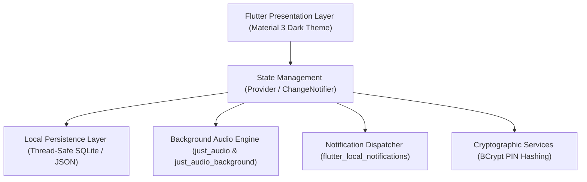

# 🌙 Noxus

> **The ultimate toolkit for lucid dreaming, sleep tracking, and subconscious mastery.**

[](https://flutter.dev)
[](https://dart.dev)
[]()
[]()
[]()
[]()

---

## 📖 Overview

**Noxus** is an all-in-one companion app engineered specifically for lucid dreamers—from complete beginners exploring conscious dreaming for the first time to experienced practitioners refining advanced induction techniques.

While you sleep, your mind progresses through cyclical sleep stages, with vivid dreams occurring predominantly during **Rapid Eye Movement (REM)** sleep. Through deliberate conditioning, memory reinforcement, and conscious habit formation, anyone can bridge the gap between subconscious sleep and conscious waking awareness: **lucid dreaming**.

Noxus combines sleep cycle management, smart auto-terminating alarms, ambient soundscapes, timestamp-based dream heatmaps, an encrypted dream journal, and a structured curriculum of proven induction techniques into an intuitive, distraction-free dark interface.

---

## ✨ Key Features

### 📓 Encrypted Dream Journal
- **Private & Secure:** Protect your most intimate dream entries with a customizable PIN code hashed with **BCrypt**. Quick double-tap anywhere on the app bar instantly locks the interface.
- **Recall & Tagging:** Record rich text details of each night's dreams. Slide left to delete, or slide right to tag the entry as a lucid dream.
- **Local Storage & PDF Export:** Store up to 300 journal entries locally on your device. Export your complete dream history into a beautifully formatted **PDF document** for archiving or external backup.
- **Voice Logs:** Integrated audio recording engine allowing you to capture spoken dream logs upon waking before memories fade.

### 🛌 Sleep Tracker & Ambient Audio
- **Seamless Soundscapes:** Built-in ambient background white noise audio player supporting continuous loop playback across multiple soothing tracks (Rain, Ocean Waves, Stream, Forest Wind, Classic White Noise).
- **Nightly Session Logging:** Activate the Sleep Tracker before bedtime to automatically queue alarms, initiate ambient audio, and log sleep sessions.
- **Mid-Night Occurrence Logging:** Long-press the quick-log trigger during the night to register dream occurrences without opening bright menus or breaking sleep posture.
- **Morning Sleep Summary:** Log recalled dream count, confirmed lucid dreams, and the specific induction techniques attempted during the night.

### ⏰ Smart Lucid Dreaming Alarms
- **Auto-Shutoff Alarms:** Alarms can be configured to ring and auto-terminate after **10 to 60 seconds**—critical for methods like **WILD** (Wake-Initiated Lucid Dreaming) where moving your body to silence an alarm disrupts sleep paralysis and hypnagogia.
- **Custom Sound Packs & Audio Recorder:** Choose from built-in alarm tones (Marimba, Bell Tower, Synth, Birds, Piano, Wind Chimes) or record custom audio prompts directly in the app.
- **Background Audio Support:** Powered by `just_audio_background` to ensure alarms and audio streams trigger reliably while your screen is off.

### 📊 Dream Heatmap & Sleep Analytics
- **Dynamic REM Heatmap:** Automatically plots your dream occurrences across the night onto a visual distribution curve, pinpointing your natural peak REM and dream windows.
- **Optimal Method Timing:** Use personal heatmap data to target alarms precisely during peak REM intervals for high-probability induction techniques (such as **WBTB** and **RAUSIS**).
- **Dream Signs Tracker:** Keep track of your recurring dream signs (surreal physics, specific locations, recurring people) to maintain strong cognitive anchors before sleep.

### 🔔 Reality Check Notification Engine
- **Daytime Conditioning:** Schedule recurring or randomized reminder notifications throughout the day to question your reality ("Are you dreaming?", "Perform a reality check").
- **Customizable Windows:** Configure active hours to match your wakeful schedule so notifications never interrupt your sleep.

### 📚 Interactive Manual
Built-in interactive manuals covering the theoretical foundations and step-by-step protocols for all major lucid dreaming methodologies:
1. **Introduction to Lucid Dreaming** — Fundamental sleep architecture and consciousness.
2. **Dream Journaling** — Systematic recall improvement and dream template reinforcement.
3. **Reality Checks** — Cultivating critical awareness and habit triggers.
4. **Dream Signs** — Identifying recurring subconscious cues.
5. **Smart Alarms** — Leveraging acoustic triggers and micro-awakenings.
6. **MILD (Mnemonic Induction of Lucid Dreams)** — Prospective memory and intentional visualization.
7. **WBTB (Wake-Back-To-Bed)** — REM cycle interruption and reactivation.
8. **WILD (Wake-Initiated Lucid Dreaming)** — Conscious transition through hypnagogia into REM.
9. **FILD (Finger-Induced Lucid Dreaming)** — Subtle physical anchors for rapid transition.
10. **SSILD (Senses-Initiated Lucid Dreaming)** — Sensory cycling conditioning.
11. **RAUSIS Method** — Acoustic stimulation paired with suggestive anchors.

### 🏆 Gamification & Milestone Tracking
- **26 Unlockable Achievements:** Rewarding dream recall streaks, journaling consistency, and lucid mastery.
- **Streak & Analytics Panel:** Live metrics tracking Current Recall Streak, Longest Streak, Total Recalled Dreams, Total Lucid Dreams, and App Usage Days.

### 🛡️ Privacy & Offline Architecture
- **Zero Cloud Tracking:** All journal entries, audio recordings, stats, and settings are stored locally on your device.
- **No Account Required:** No telemetry, third-party analytics, or cloud data harvesting.

---

## 🏗️ Architecture & Tech Stack



| Component | Library / Package | Purpose |
| :--- | :--- | :--- |
| **Framework** | [Flutter](https://flutter.dev) (Dart SDK `>=3.4.3 <4.0.0`) | Cross-platform UI toolkit |
| **State Management** | [`provider`](https://pub.dev/packages/provider) | Reactive application state and lifecycle |
| **Background Audio** | [`just_audio`](https://pub.dev/packages/just_audio) & [`just_audio_background`](https://pub.dev/packages/just_audio_background) | Background white noise and alarm playback |
| **Audio Recording** | [`record`](https://pub.dev/packages/record) & [`audio_session`](https://pub.dev/packages/audio_session) | Custom alarm tone and voice note recording |
| **Local Storage** | [`path_provider`](https://pub.dev/packages/path_provider) & [`synchronized`](https://pub.dev/packages/synchronized) | Thread-safe local file and database I/O |
| **Notifications** | [`flutter_local_notifications`](https://pub.dev/packages/flutter_local_notifications) & [`timezone`](https://pub.dev/packages/timezone) | Timed reality check push alerts |
| **Security** | [`bcrypt`](https://pub.dev/packages/bcrypt) | Salted password and PIN hashing |
| **PDF Generation** | [`pdf`](https://pub.dev/packages/pdf) | Journal export to printable PDF format |
| **Gestures** | [`flutter_slidable`](https://pub.dev/packages/flutter_slidable) | Slidable action tiles for journal entries |

---

## 📁 Project Structure

```text
app/dreamon/
├── android/               # Android native configuration and Gradle build setup
├── ios/                   # iOS native project, xcassets, and plist configurations
├── macos/                 # macOS native desktop configuration
├── web/                   # Web platform assets and manifest
├── windows/               # Windows native desktop C++ runner
├── linux/                 # Linux native desktop CMake runner
├── assets/                # App audio packs (alarms, white noise) and typography
│   ├── audio/
│   │   ├── alarm/         # Alarm sound presets (beeping, synth, marimba, etc.)
│   │   └── whitenoise/    # Ambient soundscapes (rain, waves, wind, stream)
│   └── fonts/             # Custom typography (RougeScript)
└── lib/                   # Flutter source code
    ├── main.dart          # Entry point, theme definitions, and global AppState
    ├── pages/             # Primary bottom navigation screens
    │   ├── home.dart      # Welcome dashboard, streaks & achievements
    │   ├── journal.dart   # Dream journal entry list and creation
    │   ├── log.dart       # Sleep data, Dream Heatmap & Dream Signs
    │   └── sleep.dart     # Nightly sleep schedule, alarms & Sleep Tracker
    ├── menupages/         # Drawer navigation screens
    │   ├── settings.dart  # Security PIN, audio preferences & PDF export
    │   ├── tutorials.dart # Comprehensive lucid dreaming technique manuals
    │   └── userguide.dart # Detailed feature documentation and usage tips
    ├── subpages/          # Modal workflows and detailed views
    │   ├── alarmview.dart # Single alarm configuration and auto-shutoff timer
    │   ├── cycleview.dart # Sleep cycle breakdown
    │   ├── enrtyview.dart # Single dream journal reader and editor
    │   └── recordview.dart# Custom audio alarm recorder and preview
    ├── utilities/         # Shared background services and database helpers
    │   ├── audio.dart     # JustAudio playback controller
    │   ├── bcrypthash.dart# BCrypt hashing utility for passcode security
    │   ├── dbinterface.dart# Database interface and data model serialization
    │   ├── notifications.dart# Local notification scheduling engine
    │   └── recorder.dart  # Voice capture interface
    └── widgets/           # Modular reusable UI components
        ├── amp_meter.dart # Recording level visualizer
        ├── bar_graph.dart # Dream Heatmap custom canvas bar chart
        ├── drop_card.dart # Collapsible expandable card component
        ├── hold_button.dart# Long-press action button
        ├── num_selector.dart# Custom integer scroll picker
        ├── pin_code.dart  # Secure PIN authentication pad
        └── tone_prev.dart # Audio tone preview widget
```

---

## 🚀 Getting Started

### Prerequisites
- **Flutter SDK**: `>=3.4.3 <4.0.0` ([Install Flutter](https://docs.flutter.dev/get-started/install))
- **Dart SDK**: Compatible with Flutter release
- **Platform Development Tools**:
  - **iOS/macOS**: Xcode 15+ and CocoaPods
  - **Android**: Android Studio with SDK API Level 23+ (target SDK 34)

### Installation

1. **Clone the repository:**
   ```bash
   git clone https://github.com/your-username/Noxus.git
   cd Noxus/app/dreamon
   ```

2. **Install Flutter dependencies:**
   ```bash
   flutter pub get
   ```

3. **Install CocoaPods dependencies (macOS / iOS only):**
   ```bash
   cd ios && pod install && cd ..
   ```

4. **Run the application:**
   ```bash
   # Run on connected device or simulator
   flutter run
   ```

---

## ⚙️ Configuration & Sensitive Files

To safeguard sensitive credentials, API keys, privacy, and proprietary branding assets, the following files and patterns are excluded via `.gitignore`:

| File / Pattern | Purpose | Action Required if Cloning |
| :--- | :--- | :--- |
| `ios/Runner/GoogleService-Info.plist` | iOS Firebase configuration | Place your own Firebase configuration plist if integrating Firebase services. |
| `android/app/google-services.json` | Android Firebase configuration | Place your own Firebase configuration json if integrating Firebase services. |
| `firebase_options.dart`, `*firebase*.json` | FlutterFire configuration & service credentials | Re-generate via `flutterfire configure` or provide your own project options. |
| `key.properties` & `*.keystore` / `*.jks` | Android release signing keystores & configs | Copy `android/key.properties.example` to `android/key.properties` and add your signing keys. |
| `local.properties` | Local Android/Flutter SDK path references | Automatically generated by Flutter / Android Studio upon build. |
| `*.p12`, `*.p8`, `*.mobileprovision`, `*.cer` | Apple developer certificates, push keys & profiles | Supply your own developer team certificates & provisioning profiles for iOS/macOS release builds. |
| `.env`, `.env.*`, `secrets.json`, `secrets.yaml` | Environment variables and secret configurations | Provide local environment configuration files for custom environment variables. |
| `sentry.properties` | Crashlytics / Sentry auth & upload tokens | Configure with your own project DSN and auth tokens if enabling crash reporting. |
| `*.sqlite`, `*.sqlite3`, `*.db`, `*.sql`, `*.dump` | Local database instances & data dumps | Created locally at runtime; stores local offline journal entries & app settings. |
| `assets/icon.png`, `assets/moon.png`, `assets/launch.png` | Proprietary source branding artwork & launch graphics | Supply custom brand icons or generate platform launcher icons via `flutter_launcher_icons`. |
| Platform launcher icons (`mipmap-*`, `AppIcon.appiconset`, `web/icons/`, etc.) | Generated platform application icons & launch image sets | Generated from source icons during build or asset configuration. |

---

## 📱 Platform & Background Audio Notes

### iOS Background Audio
Due to iOS power management policies:
- Keep Noxus open or running in the background when initiating an active **Sleep Tracker** session.
- Ambient white noise and scheduled alarms utilize background audio session modes (`UIBackgroundModes: audio`) to continue playback with the screen locked.
- Ensure your device is connected to a charger for overnight tracking sessions.

### Android Alarms & Notifications
- Android 13+ (API 33+) requires explicit notification permission approval for reality check reminders.
- Ensure battery optimization is disabled for Noxus if aggressive OEM power management restricts background alarm playback.

---

## 📄 License

This project is licensed under the MIT License - see the LICENSE file for details.
